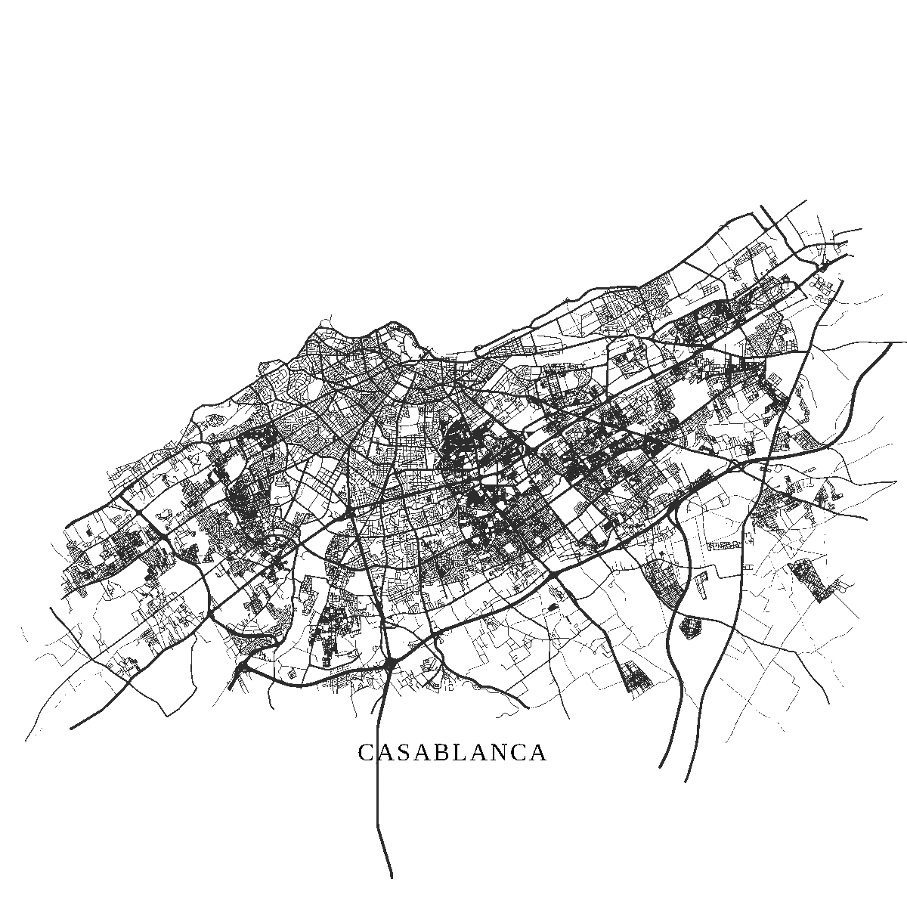

<h1 align="center">
  <strong>City Lines</strong>
  <br />
  <em>Turn your city into minimalist street-network art.</em>
</h1>

<p align="center">
  <a href="https://citylines-art.vercel.app/"><strong>Live app</strong></a> ·
  <a href="#use-it-with-your-own-map-data">Self-host</a> ·
  <a href="#support-the-project">Support</a> ·
  <a href="https://github.com/abdel-mars/city-canvas/issues">Report an issue</a>
</p>

<p align="center">
  <a href="LICENSE"></a>
  <a href="https://citylines-art.vercel.app/"></a>
  
  
  
  <a href="https://www.openstreetmap.org/copyright"></a>
</p>

---

Search for any city on Earth and watch its road network resolve into a piece of minimalist
wall art. Adjust the mood, the typography and the framing, then download it as a crisp PNG or
SVG — or have it printed on museum-grade matte paper and shipped anywhere in the world.

<p align="center"></p>

## What it does

- **Any city, anywhere** — search a place name and its streets are fetched live from OpenStreetMap
- **Real cartography, not a texture** — genuine road geometry, simplified with Douglas–Peucker
- **Six moods** — Classic, Minimal, Sand, Navy, Mars and a neon preset
- **Four typefaces** — Cormorant Garamond, DM Sans, JetBrains Mono and Caveat
- **Export anywhere** — PNG (up to 4000px), transparent-background PNG, or raw vector SVG
- **Print on demand** — order a real square-format poster through Printify without leaving the page
- **Social Studio** — admins can queue an artwork for Instagram and Pinterest, track Pinterest
  clicks, and let a scheduled worker publish and clean up automatically

<p align="center">
  
</p>

## Quick start

Requires **Node 20 or newer**.

```bash
git clone https://github.com/abdel-mars/city-canvas.git
cd city-canvas
npm install
cp .env.example .env      # then fill in GEOCONTACT at minimum
npm run dev               # http://localhost:3000
```

`GEOCONTACT` must be your own email or URL. It is sent as the `User-Agent` to OpenStreetMap's
Nominatim and Overpass, which permanently ban clients that do not identify themselves, so the
proxy refuses to call them without it and `npm run dev` will not start.

The artwork editor works with nothing but `GEOCONTACT` set. Everything else — caching,
printing, accounts — is optional and degrades gracefully.

| Script | What it does |
| --- | --- |
| `npm run dev` | Full stack via `vercel dev` on **port 3000** — app **and** the `api/` functions (city search, road loading) |
| `npm run dev:ui` | Vite alone, port 8080. Faster, for pure UI work. **The API does not run**, so city search will not work |
| `npm run build` | Production build into `dist/` |
| `npm run preview` | Serve the production build locally |
| `npm test` | Run the test suite (Vitest) |
| `npm run lint` | Lint with ESLint |

`npm run dev` uses `vercel dev` under the hood, because `api/` holds Vercel serverless functions
that the plain Vite server cannot execute. `dev:full` remains as an alias for `dev`.

`npm run dev` also needs `redis.txt` and `token-printify.txt` in the project root (both
gitignored). Without them the Upstash cache and the paid Printify calls are unavailable; use
`dev:ui` if you do not have them.

## Use it with your own map data

This is the part worth reading. City Lines is deliberately small and readable, and every piece
of geography is swappable.

### Point it at your own Overpass instance

The public servers at `overpass-api.de` are shared, rate-limited infrastructure. If you run your
own — or a paid provider — edit the mirror list at the top of `api/geo.ts`:

```ts
const OVERPASS_MIRRORS = [
  'https://overpass.kumi.systems/api/interpreter',
  'https://z.overpass-api.de/api/interpreter',
  'https://overpass.private.coffee/api/interpreter',
  'https://overpass-api.de/api/interpreter',   // keep the public one as a last resort
];
```

The proxy tries them in order, remembers whichever last worked, and fails over after 8 seconds.
Add yours to the front and it becomes the primary.

> **This must stay server-side.** Browsers cannot set a `User-Agent` header, and Overpass
> refuses browser clients with a `406` whose error page carries no CORS headers — so the failure
> shows up in the console as a bogus *"blocked by CORS policy"* message. Moving the request into
> a serverless function is the only thing that makes it work.

### Swap the place search

City names come from Nominatim (`NOMINATIM_URL` in `api/geo.ts`). To use your own gazetteer, a
GeoJSON index, or a fixed list of cities, either point that constant at your service or bypass
it entirely and return `City[]` objects yourself:

```ts
interface City {
  name: string;
  displayName: string;
  lat: number;
  lon: number;
  boundingBox: [number, number, number, number];  // south, west, north, east
}
```

Then call your own endpoint from `src/hooks/useCitySearch.ts` instead of `/api/geo`.

### Change the look

All of the visual identity lives in `src/lib/presets.ts`:

- `colorPresets` — the six colour moods
- `fontMap` / `fontLabels` — the four typefaces
- `featuredCities` — the cities behind the landing-page background art

Add a preset, drop a Google Font into `index.html`, and you have a new mood.

### Tune the geometry

In `api/geo.ts`:

- `MAX_BBOX_SPAN` (default `0.35°`) rejects metro-sized boxes that would time out
- `EPSILON` (default `0.00005`, ≈5 m) controls line simplification — raise it for a lighter,
  faster render
- `MAX_WAYS` / `MAX_POINTS` cap the payload

### Drop the print shop entirely

The Printify integration is completely optional. For a pure download tool, delete
`api/create-printify.ts` and remove the *Gift it* button and its confirmation dialog from
`src/components/DownloadShare.tsx`. Nothing else depends on it, and no Printify account is
needed.

To keep printing but use your own store, point `PRINTIFY_API_KEY`, `PRINTIFY_SHOP_ID` and
`PRINTIFY_STORE_DOMAIN` at your own account. The poster is created from blueprint `282`
("Matte Vertical Posters") with square sizes only, because the artwork is 1:1.

## Configuration

Every variable is documented in [`.env.example`](.env.example). Nothing secret is ever prefixed
with `VITE_`, so nothing secret can reach the browser.

| Variable | Required | Purpose |
| --- | --- | --- |
| `GEOCONTACT` | **Yes** | Your email or URL, sent as the `User-Agent` when calling Overpass. Overpass permanently bans clients that do not identify themselves, so there is no safe default. |
| `APP_ORIGIN` | Yes | Absolute origin of your deployment. CORS is locked to exactly this string. |
| `UPSTASH_REDIS_REST_URL` | Recommended | Redis cache. Without it the proxy falls back to per-instance memory, which is far less effective. |
| `UPSTASH_REDIS_REST_TOKEN` | Recommended | As above. |
| `PRINTIFY_API_KEY` | Optional | Personal Access Token. Needed only for the print shop. |
| `PRINTIFY_SHOP_ID` | Optional | Numeric shop id of your Pop-Up Store. |
| `PRINTIFY_STORE_DOMAIN` | Optional | Your store subdomain, without `.printify.me`. |
| `PRINT_PROVIDER_ID` | Optional | Pins a print provider instead of using the catalog's first. |
| `INCLUDE_LARGE` | Optional | `true` also offers the 28″×28″ poster, which has a much higher base cost. |
| `VITE_SUPABASE_URL` | Optional | Only for the account and gallery features. |
| `VITE_SUPABASE_PUBLISHABLE_KEY` | Optional | Supabase anon key. Safe to ship; RLS is the real access control. |
| `VITE_SUPABASE_PROJECT_ID` | Optional | Supabase project ref. |
| `SUPABASE_URL` | Social only | Server-side Supabase project URL for the queue, worker, and cleanup. |
| `SUPABASE_SERVICE_ROLE_KEY` | Social only | Server-only key used by the social APIs. Never expose it to the browser. |
| `SOCIAL_CRON_SECRET` | Social only | Shared secret checked by `/api/social-tick` and `/api/social-cleanup`. |
| `INSTAGRAM_ACCESS_TOKEN` | Social only | Instagram Login long-lived token. |
| `INSTAGRAM_USER_ID` | Social only | Instagram professional account id. |
| `PINTEREST_ACCESS_TOKEN` | Social only | Pinterest API v5 token. |
| `PINTEREST_BOARD_ID` | Social only | Destination Pinterest board. |
| `PINTEREST_BOARD_SECTION_ID` | Social only | Optional board section. |
| `SOCIAL_WORKER_BATCH` | Social only | Posts claimed per tick, 1–5. Defaults to 2. |
| `SOCIAL_SHOP_URL` | Social only | Optional override for the shop destination. |
| `SOCIAL_TRACKING_ENABLED` | Social only | Set `false` to publish direct shop links and skip click logging. |

## How it works

```
Browser ──POST /api/geo──────────► Vercel function ──► Overpass / Nominatim
                                        │
                                        ├─ 6 mirrors, 8s timeout, sticky winner
                                        ├─ Redis cache: one fetch per city, forever
                                        ├─ single-flight: 5 callers → 1 upstream request
                                        ├─ rate limit 60/hr/IP, serves stale when over
                                        └─ simplify + compact [lat, lon] tuples

Browser ──POST /api/create-printify──► Vercel function ──► Printify API
                                        │
                                        ├─ dedupe by design-hash tag
                                        ├─ square poster sizes, priced above cost
                                        └─ polls for the storefront URL

Admin ──POST /api/social-queue──► Vercel function ──► Supabase
                                      │
                                      ├─ uploads the JPEG master to `shares`
                                      ├─ inserts one post per platform
                                      └─ reserves the next free local slot

pg_cron ──POST /api/social-tick──► Vercel worker ──► Instagram / Pinterest
                                      │
                                      ├─ claims due posts with a 10-minute lock
                                      ├─ sharp: 1080px Instagram / 1000×1500 Pinterest
                                      ├─ retries transient failures with backoff
                                      └─ deletes the social variant after success

pg_cron ──POST /api/social-cleanup──► Vercel worker ──► Supabase Storage
                                      ├─ sweeps leftover social variants
                                      └─ replaces originals with 640px thumbnails after 7 days
```

Two details worth knowing if you plan to modify it:

**The storefront URL cannot be guessed.** Printify's API returns a Mongo ObjectId
(`6a21115f…`) but the Pop-Up Store needs a numeric id (`29074930`). That numeric id only appears
in `product.external.handle` *after* publishing, so the endpoint publishes and then polls for it.
Building the URL yourself produces a 404.

**The user's IP is read from the rightmost `X-Forwarded-For` entry.** The leftmost entries are
client-supplied; trusting them lets anyone mint a fresh rate-limit bucket with one header.

## Deploying

The app is a standard Vite build with an `api/` directory, so it deploys cleanly to
[Vercel](https://vercel.com) with no configuration:

```bash
npx vercel
```

`vercel.json` handles the SPA rewrite for client-side routes while leaving `/api/*` alone.

The rewrite excludes `src/`, `@vite`, `@react-refresh` and `node_modules/`. Those are dev-server
internals that exist only under `vercel dev`, and Vercel applies rewrites ahead of the dev-server
proxy — an unexcluded catch-all answers those paths itself and returns 404 for every module
script, so the app never mounts in a browser. Nothing user-facing starts with those prefixes, so
deployed behaviour is unchanged.

To deploy anywhere else, build with `npm run build` and serve `dist/` as a static site, and
deploy `api/` as Node 20+ serverless functions. Remember to set `GEOCONTACT` and `APP_ORIGIN`.

The social worker and cleanup functions need 60 seconds and 1024 MB because they use `sharp`.
Set the social environment variables described below and create the Supabase cron jobs; without
them the studio can still queue artwork, but nothing will publish.

## Social Studio automation

The app includes an admin-only Social Studio at `/studio/social`. It turns the editor into a
small publishing pipeline rather than a one-off download tool.

Only `elmahmoudiabderrahmane@gmail.com` can open the studio or call the social APIs. The same
address is enforced by Supabase RLS through `public.is_admin()`.

### Schedule

| Platform | Days | Local times (`Africa/Casablanca`) | Posts/week |
| --- | --- | --- | --- |
| Instagram | Mon, Wed, Fri | 12:00 | 3 |
| Pinterest | Sun, Mon, Wed, Fri | 09:00, 12:00, 20:00 | 12 |

The queue chooses the next free slot after `now + 15 minutes`. Artworks are never repeated
automatically, and idle slots stay empty. Times are stored in UTC and displayed in local time.

### Admin flow

1. Generate an artwork and open **Download & share**.
2. Choose **Publish & schedule**.
3. The browser renders a JPEG master at 3×, falling back to 2× if it would exceed the upload cap.
4. `/api/social-queue` uploads the master, creates the share, and queues one Instagram and one
   Pinterest post with copy and tracked links.
5. Review everything in `/studio/social`: queue, published posts, click counts, last errors, and
   needs-review items. Pending posts can be cancelled or retried.

### Implementation phases

All nine phases are implemented and committed on the `automation` branch:

| Phase | Commit | What shipped |
| --- | --- | --- |
| 1 | `1e22123` | Social schema, RLS, `is_admin()`, claim RPC, shared scheduling and copy templates, tests |
| 2 | `0199d4e` | Admin-only `/studio/social` shell and route protection |
| 3 | `ef301df` | Admin queue API, JPEG upload, tracked links, click redirect |
| 4 | `605e379` | Queue/published/needs-attention views, cancel/retry, Publish & schedule action |
| 5 | `3f2ef83` | Worker claim/retry loop, sharp image variants, credentials, cron secret |
| 6 | `9e9d40f` | Instagram publisher: container, polling, publish, permalink, resumable state |
| 7 | `8f0c371` | Pinterest publisher with tracked links and retry-safe pin checkpoints |
| 8 | `4d5e455` | Weekly cleanup: variant removal, 640px thumbnails, original deletion |
| 9 | this documentation | README phase history plus the full operations guide |

The phase table is also kept in [`docs/social-automation.md`](docs/social-automation.md), which
covers credentials, Supabase migrations, `pg_cron`/`pg_net` setup, endpoint summaries, retries,
tracking, retention, and deployment caveats.

### Worker behavior

- Every 5 minutes, Supabase `pg_cron` calls `/api/social-tick` with `SOCIAL_CRON_SECRET`.
- The worker claims up to `SOCIAL_WORKER_BATCH` due posts (default 2, max 5) and locks each for
  10 minutes.
- Instagram creates a media container, polls until `FINISHED`, publishes, then fetches the
  permalink. Container and media ids are checkpointed so retries resume instead of double-posting.
- Pinterest creates a pin with the tracked link and checkpoints the pin id.
- Transient failures retry after 5, 15, 60, then 180 minutes. Authentication, permission, and
  invalid-media failures move to `needs_review`. After four attempts, retryable failures become
  `failed`.

### Tracking and retention

- Pinterest links are per-post: `/api/social-click?p=<social_post_id>`.
- Instagram uses one bio campaign: `/api/social-click?c=instagram-bio`.
- Clicks record only post/campaign, platform, and timestamp; no IP or user-agent data is stored.
  The redirect to the shop always happens, even if logging fails.
- `SOCIAL_TRACKING_ENABLED=false` publishes direct shop links and disables click logging.
- Social variants are deleted after a successful publish.
- Seven days after the last successful post, `api/social-cleanup` replaces the original with a
  640px JPEG thumbnail. Shares with `pending`, `posting`, `failed`, or `needs_review` posts are
  skipped. Share rows, post rows, and click rows are retained.

### Setup

1. Apply the two social migrations in `supabase/migrations/`.
2. Set the social environment variables from the configuration table above.
3. Add Instagram and Pinterest credentials, either as environment variables or rows in
   `social_credentials`.
4. Create the `pg_cron` and `pg_net` jobs from
   [`docs/social-automation.md`](docs/social-automation.md#cron-with-pg_cron-and-pg_net).
5. Point the Instagram bio link at
   `https://YOUR_APP_ORIGIN/api/social-click?c=instagram-bio`.

`/api/social-tick` and `/api/social-cleanup` both fail closed when `SOCIAL_CRON_SECRET` or the
server Supabase credentials are missing. They accept `x-social-secret` or a
`Authorization: Bearer <secret>` header.

> Live publishing is the only part that cannot be verified without real Meta and Pinterest
> credentials. Everything else is covered by mocked tests. Vercel Hobby is non-commercial, and a
> paused Supabase free project stops scheduled publishing.

## Troubleshooting

| Symptom | Cause |
| --- | --- |
| City search returns nothing, dropdown stays blank | You started `npm run dev:ui`. Vite alone cannot execute the `api/` functions, so `/api/geo` is unrouted. Use `npm run dev`. The UI now says so explicitly. |
| *"City search is not configured. Set GEOCONTACT in .env and restart."* | `GEOCONTACT` is unset. The proxy returns `503 unconfigured` rather than calling OpenStreetMap unidentified. |
| *"blocked by CORS policy"* on the Overpass URL | Misleading. The real status is `406`: something is calling Overpass from a browser. Route it through `/api/geo`. |
| Road data never loads, endpoint returns `503` | `GEOCONTACT` or the Redis credentials are missing. The proxy fails closed rather than hammer the upstream unidentified. |
| `"Printing is unavailable"` | `PRINTIFY_API_KEY` or `PRINTIFY_SHOP_ID` is unset. |
| Searches return `429` | 60 requests/hour per IP, shared between search and road loading. Past the cap the proxy serves a stale cached copy when it has one. |
| Large cities come back empty | The bounding box exceeded `MAX_BBOX_SPAN`. Nominatim returns administrative areas, which can be much bigger than the city. |
| `/studio/social` redirects home | You are signed in as a non-admin. Only `elmahmoudiabderrahmane@gmail.com` is allowed. |
| `/api/social-tick` returns `503 social_worker_unconfigured` | `SOCIAL_CRON_SECRET`, `SUPABASE_URL`, or `SUPABASE_SERVICE_ROLE_KEY` is missing. |
| Social posts stay in `posting` | The worker did not finish. The 10-minute lock lets the next tick reclaim the post; check the Vercel function logs and `pg_cron` job history. |
| Instagram posts fail with a container timeout or media error | Verify the `social-media` bucket is public and the image URL is reachable, then retry the post from the studio. |
| Pinterest returns `401` or `403` | Rotate `PINTEREST_ACCESS_TOKEN` and confirm the board id belongs to the token's account. |
| Cleanup never runs | Enable `pg_cron` and `pg_net`, then re-run the schedule SQL in the automation guide and check `cron.job_run_details`. |

## Support the project

City Lines is free and open source. If it gave you something you like:

- **Get your own city** → [citylines-art.vercel.app](https://citylines-art.vercel.app/)
- **Gift a real print** → [citylines-art.printify.me](https://citylines-art.printify.me/)

## Credits

- Street and place data © [OpenStreetMap contributors](https://www.openstreetmap.org/copyright),
  available under the [Open Database License](https://www.openstreetmap.org/copyright) (ODbL)
- Typefaces: [Cormorant Garamond](https://fonts.google.com/specimen/Cormorant+Garamond),
  [DM Sans](https://fonts.google.com/specimen/DM+Sans),
  [JetBrains Mono](https://fonts.google.com/specimen/JetBrains+Mono),
  [Caveat](https://fonts.google.com/specimen/Caveat)
- Print-on-demand fulfilment by [Printify](https://www.printify.com)
- Built with [React](https://react.dev), [Vite](https://vite.dev),
  [Tailwind CSS](https://tailwindcss.com) and [shadcn/ui](https://ui.shadcn.com)

### A note on OpenStreetMap

This project uses publicly donated geography and relies on free community infrastructure.
Overpass asks that you identify yourself, keep request volume low, and avoid parallel retries;
the caching, mirroring and rate limiting here exist partly to honour that. If you deploy this,
please keep `GEOCONTACT` set to a real address and consider
[donating to OpenStreetMap](https://openstreetmap.org/donate) or running your own Overpass
instance. Attribution must be preserved if you redistribute rendered output.

## License

MIT © [El Mahmoudi Abderrahman](https://github.com/abdel-mars) — see [LICENSE](LICENSE).

You are free to use, modify and redistribute this project, including commercially. Attribution
is appreciated but the only requirement is keeping the copyright notice.
